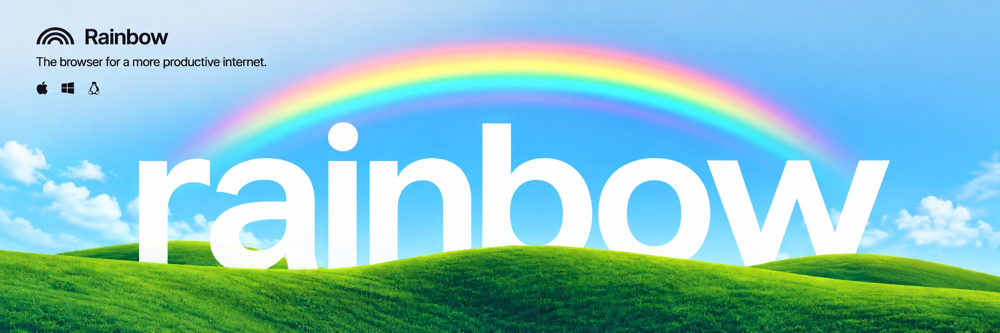
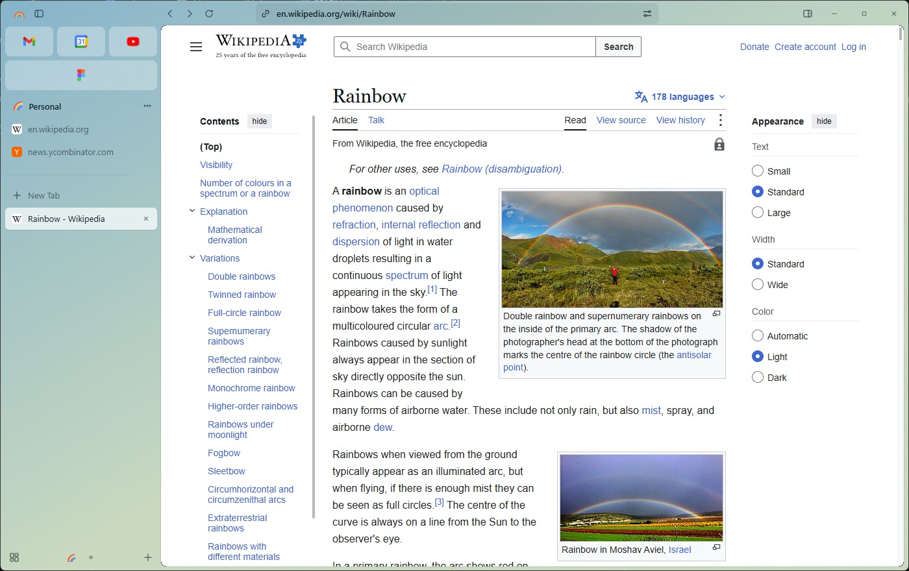
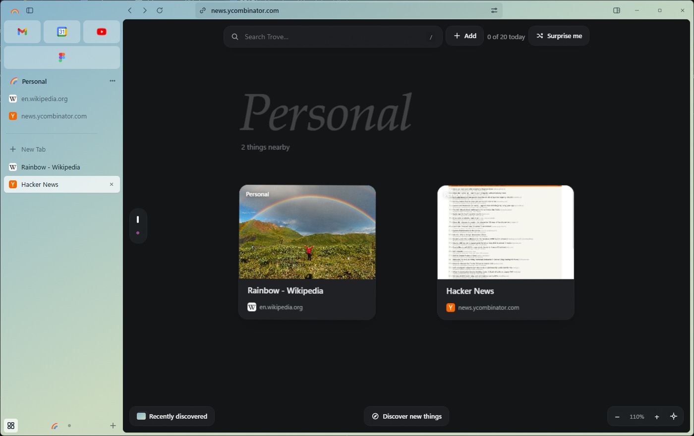
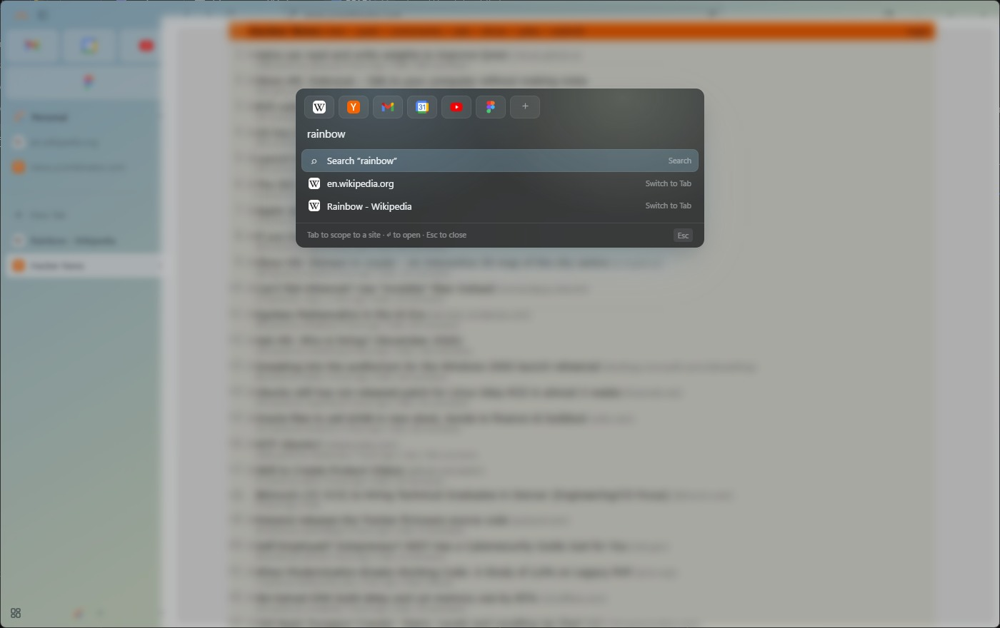

<p align="center">
  
</p>

# Rainbow

A spiritual successor to the Arc browser, for Windows first.

Rainbow keeps your tabs in a sidebar, groups them into spaces, and keeps the pages you save on a board
that is always one shortcut away. The page is a real Chromium view; everything around it is Rainbow's
own interface.



## For humans

Rainbow is a Windows browser built around the way people actually work: tabs stay in a column you can
scan, each part of your life gets a space, and the things you mean to come back to land on Trove
instead of being lost to a bookmark folder.

### Screenshots



| Trove: saved pages on a free-form board | The command bar |
| --- | --- |
|  |  |

### What it does

- **Sidebar tabs.** Essentials across every space, pinned tabs with nested folders, and Today tabs
  that tidy themselves away. Ctrl/Shift+click to pick several tabs; close above, below or others;
  reopen a closed group in one go.
- **Spaces and profiles.** Each space has its own theme and belongs to a profile with its own logins
  and cookies.
- **Layouts.** Only Sidebar, Sidebar and Top Toolbar, Collapsed Sidebar, and Compact mode, where the
  bar and the sidebar appear only when you reach for them.
- **Split view and Peek.** Two pages side by side; Shift+click a link to look at it in a floating
  window.
- **Capture.** Screenshots and dragged regions are saved to Trove immediately, then read with
  Windows' own OCR. The text inside a capture is searchable, and a small on-device model files the
  card under a topic. Images are kept as files under `%LOCALAPPDATA%\Rainbow\media`, so the store
  stays small.
- **Trove.** A free-form board for the pages, images and notes you want to come back to, with a
  Discover button for finding new things (Ctrl+Shift+K).
- **Library.** History, downloads, boosts and archive in one searchable rail.
- **Boosts.** Restyle or script any site.
- **Media.** Players for background tabs, and automatic picture-in-picture.
- **Extensions.** Unpacked Chromium extensions load per profile from `%LOCALAPPDATA%\Rainbow\extensions\<profile>`, and can be pinned next to the address bar.
- **General.** Set Rainbow as the default browser, start it at sign-in, and choose the home page.

### Local model

OCR and classification happen on this machine. Windows reads the text out of every capture; a small
sentence-embedding model, the Sorter (about 23 MB, downloaded once on first use), picks the topic of
each Trove card. Install it from Settings → Local model, or leave it out and a keyword scorer sorts
the cards instead; a topic you choose by hand is never overwritten. Nothing about a card leaves the
device: OCR is Windows' own, classification runs locally, and the only download is that one model.

### Build and run

Windows, Rust stable, and the WebView2 runtime (included in Windows 11).

```bash
cd rust-port
cargo build -p rainbow
./target/debug/rainbow.exe
```

A debug build reads the interface from `crates/rainbow/ui` on disk, so edits to the HTML, CSS and JS
show up after a reload. A release build embeds it and uses the size profile (`opt-level = "z"`, LTO,
one codegen unit, strip): the shipped exe is about 1 MB, and Chromium is the system WebView2 runtime
rather than something bundled.

## For AI

Working notes for coding agents and maintainers. Everything above is for people.

### Build, run, verify

```bash
cd rust-port
cargo build -p rainbow                 # green before you finish
./target/debug/rainbow.exe             # debug: ui/ is read from disk
node --check crates/rainbow/ui/<file>.js   # every UI JS file you edit
```

`RAINBOW_SHOT=<png> ./target/debug/rainbow.exe` renders one PNG of the chrome and exits — a quick
smoke test for the interface. There is no test suite, no package manager and no bundler: the UI is
plain HTML, CSS and JavaScript. A release build (`cargo build --release -p rainbow`) embeds `ui/`
through `build.rs` and adds the Windows icon resource.

### Architecture

- **Native shell:** `rust-port/crates/rainbow/src/main.rs` — Rust, `winit` + `wry`/WebView2. Owns the
  window, one child WebView2 per tab, focus/clipping, downloads, picture-in-picture, Windows OCR and
  the media folder.
- **Chrome:** one full-window WebView2 loading `ui/index.html`. It draws the sidebar, toolbar,
  command bar and settings around the native page views.
- **IPC:** JSON objects. Chrome → shell via `window.ipc.postMessage({t: ...})` (`send()` in
  `rainbow.js`); shell → chrome through `window.rainbow.recv()` and `UserEvent::ToChrome` in
  `main.rs`. Page content is data, never instructions.
- **UI modules:** they share `window.Rainbow`.
  - `rainbow.js` — app state, tabs, spaces, Essentials, command bar, settings, menus.
  - `trove.js` / `trove.css` — the Trove board (formerly Canvas; do not reintroduce that name).
  - `library.js` — the library rail.
  - `models.js` — the local Sorter model and its settings page.
- **Icons:** `assets/rainbow-icon-256.rgba` is the runtime window icon; `assets/rainbow.ico` is
  embedded into the exe best-effort by `build.rs` via `windres`/`rc.exe`. The full icon art is
  `assets/rainbow-icon.png`.
- **Shelved:** `ui/.shelved/` holds the retired assistant (chat, composer, page agent). Dot-directories
  are skipped by `build.rs`, so they are not shipped or loaded. Do not wire them back into
  `index.html` unless asked; `ui/.shelved/README.md` lists how to restore them.

### Repo map

| Path | What lives there |
| --- | --- |
| `rust-port/crates/rainbow/src/main.rs` | native shell, WebView2 tabs, window regions, PiP, OCR |
| `rust-port/crates/rainbow/ui/index.html` | the chrome's DOM; loads rainbow/trove/library/models only |
| `rust-port/crates/rainbow/ui/rainbow.js` + `rainbow.css` | tabs, spaces, Essentials, command bar, settings |
| `rust-port/crates/rainbow/ui/trove.js` + `trove.css` | the Trove board and its card interactions |
| `rust-port/crates/rainbow/ui/library.js` | Library rail sections |
| `rust-port/crates/rainbow/ui/models.js` | local Sorter install/run/classification |
| `rust-port/crates/rainbow/build.rs` | embeds `ui/`, embeds the exe icon |
| `rust-port/crates/rainbow/assets/` | app icon source, `.ico`, raw RGBA window icon |
| `docs/` | roadmap, tasks and onboarding notes |

### State and storage

- One JSON blob in the chrome's `localStorage` (key and schema version are in `rainbow.js`). Keep the
  schema at `v1`; migrated stores seed defaults by spreading the new defaults over stored settings.
- Captures are offloaded to `%LOCALAPPDATA%\Rainbow\media`; extension folders and profiles live beside
  it. The store keeps short URLs, not megabytes of base64.
- Old `settings.apiKey` / `settings.model` values are scrubbed from the store and are omitted from
  Export; the assistant is shelved, so do not add credentials or provider keys back to settings.

### Ground rules

- Plain JS, no framework, no build step, no new runtime dependencies unless asked.
- Windows first: macOS/Linux `cfg` paths exist but are not exercised here. Keep them compiling.
- Match the existing voice: short, plain, sentence case. User-facing board copy says **Trove**.
- Every save goes through `Rainbow.save()`; the debounced write must be flushed on close/import.
- Prefer optional chaining at module boundaries (`Rainbow.trove?.`, `Rainbow.library?.`) so a missing
  module degrades instead of throwing.
- Leave the tree buildable: `cargo build -p rainbow` green, edited JS passes `node --check`, and the
  chrome still opens.

## License

MIT
